# BRÛLÉ — Specialty Coffee Lab

Toko kopi specialty **roast-on-demand**: biji baru disangrai setelah pesanan masuk. Pembeli memilih biji, level sangrai, ukuran, dan gilingan lewat *roast builder*; roastery dan admin mengurus antrian, stok, dan laporan dari panel internal. Dikerjakan sebagai tugas kuliah web e-commerce.

**Stack:** Laravel 13 · Livewire 3 (+ Volt untuk halaman auth) · Tailwind CSS · Alpine.js · D3 · Pest · MySQL (sqlite untuk dev/test).

## Tampilan

**Toko**

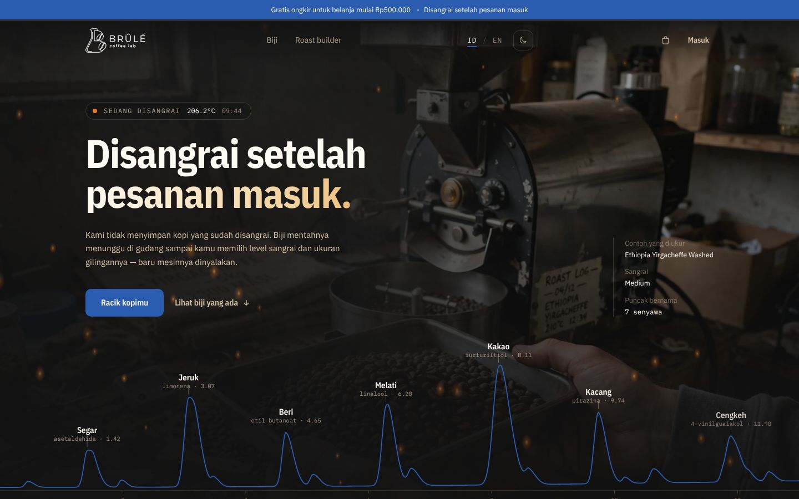

| | |
|---|---|
| 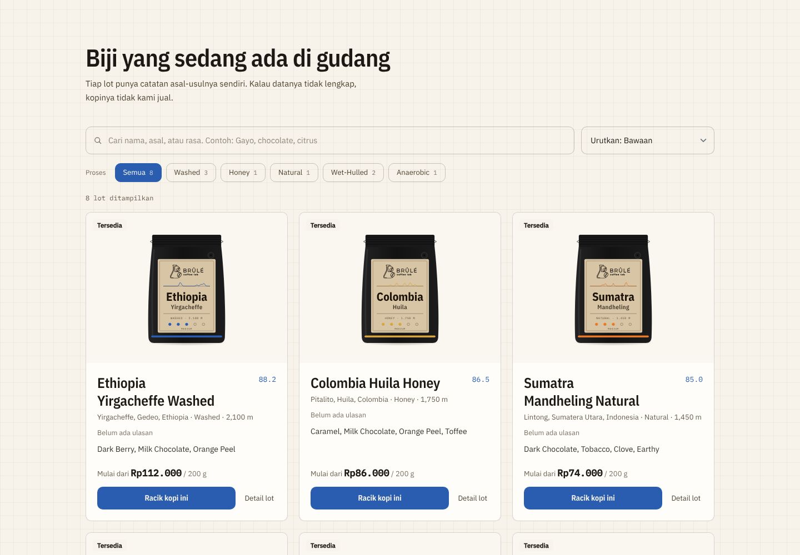<br>**Katalog**: harga, stok, rating, cari, sortir | 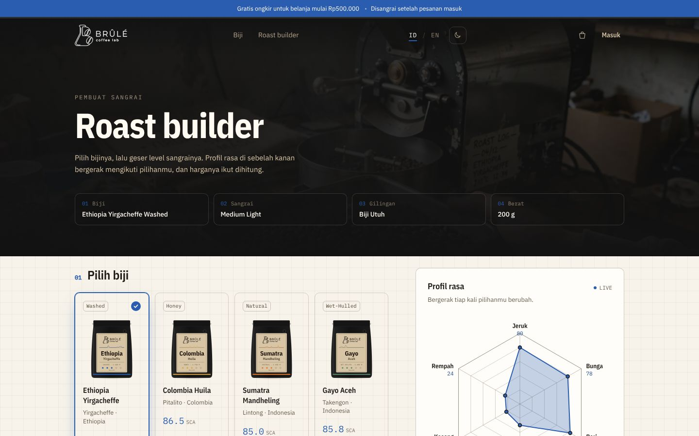<br>**Roast builder**: level sangrai, flavor wheel |
| 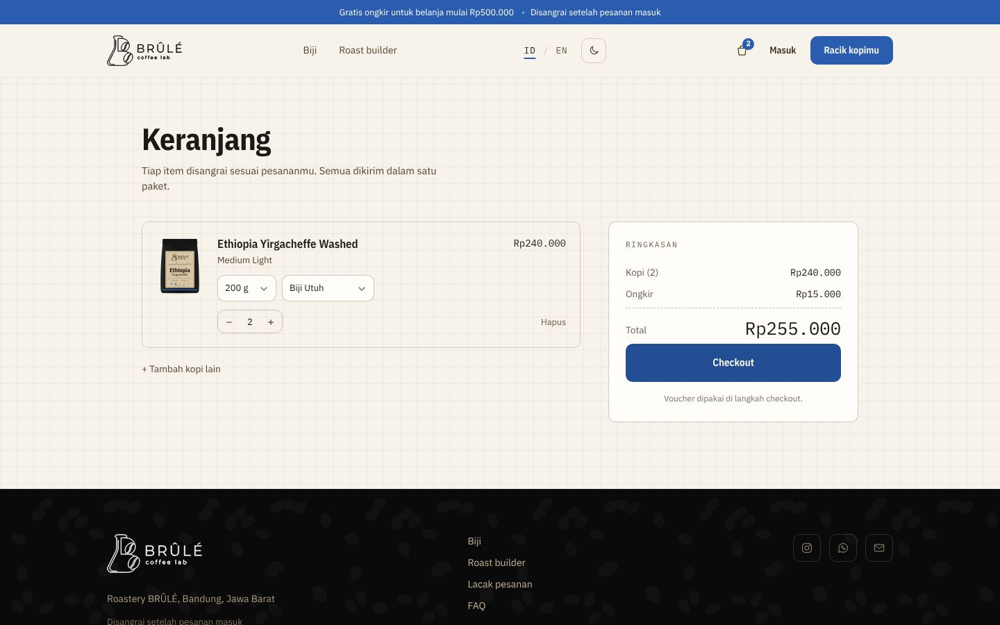<br>**Keranjang** multi-item | 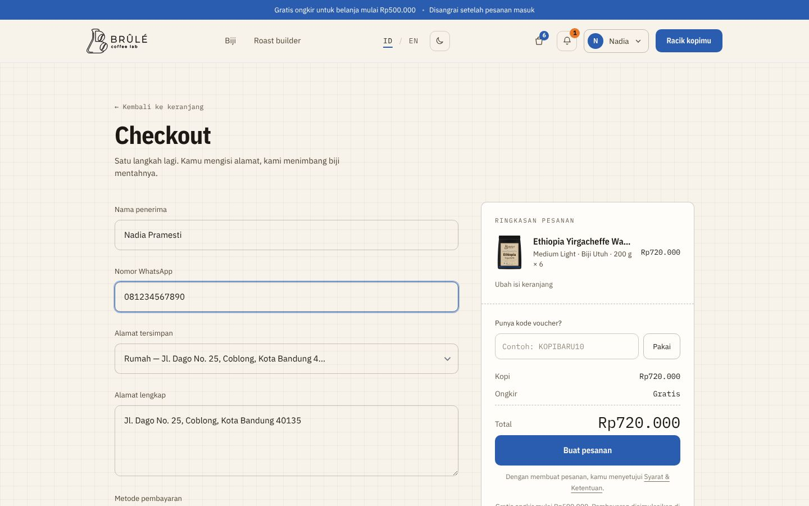<br>**Checkout**: alamat tersimpan, voucher, online / COD |
| 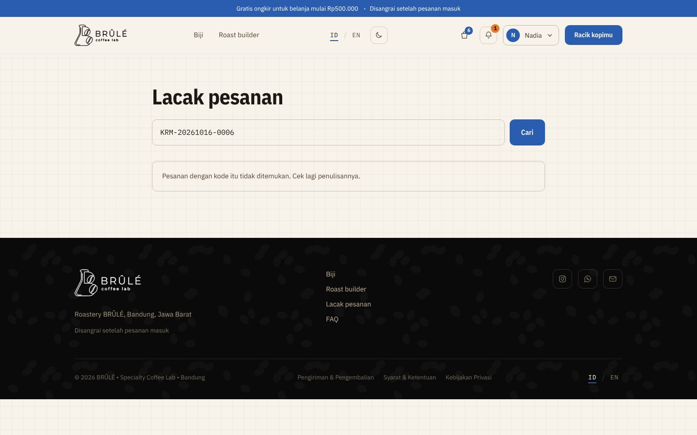<br>**Lacak pesanan** per tahap produksi | 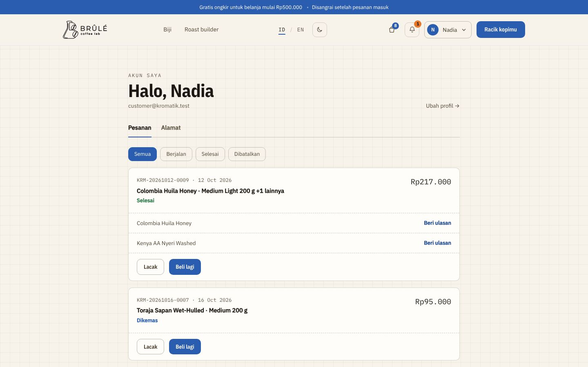<br>**Akun saya**: riwayat, Beli lagi, ulasan |

**Panel admin** (tema gelap)

| | |
|---|---|
| 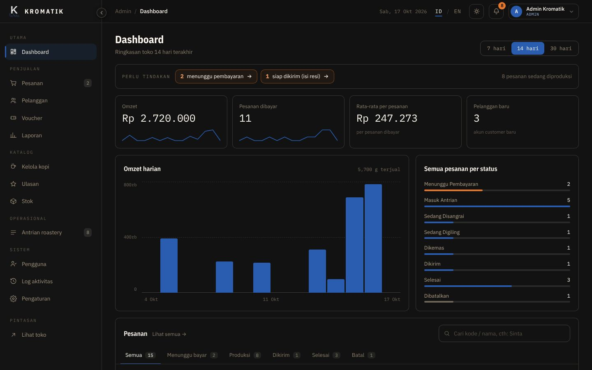<br>**Dashboard** | 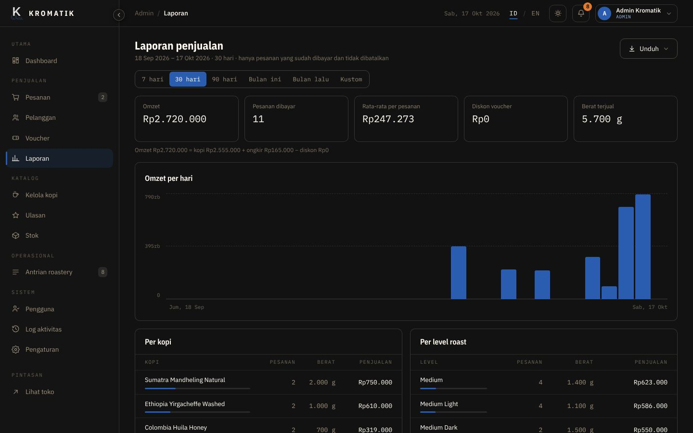<br>**Laporan** (ekspor Excel / PDF) |
| 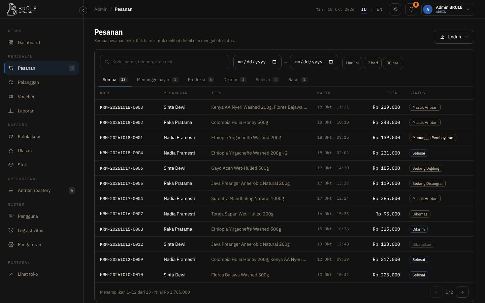<br>**Pesanan** | 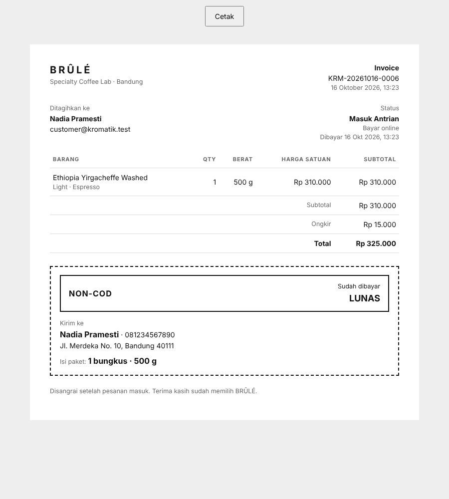<br>**Invoice / label kirim** (COD vs NON-COD) |

**Mobile**

<p>
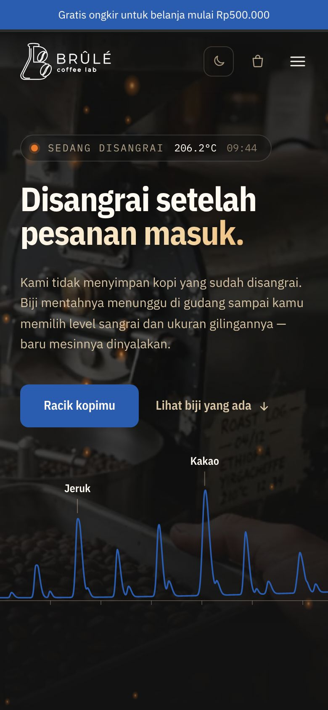
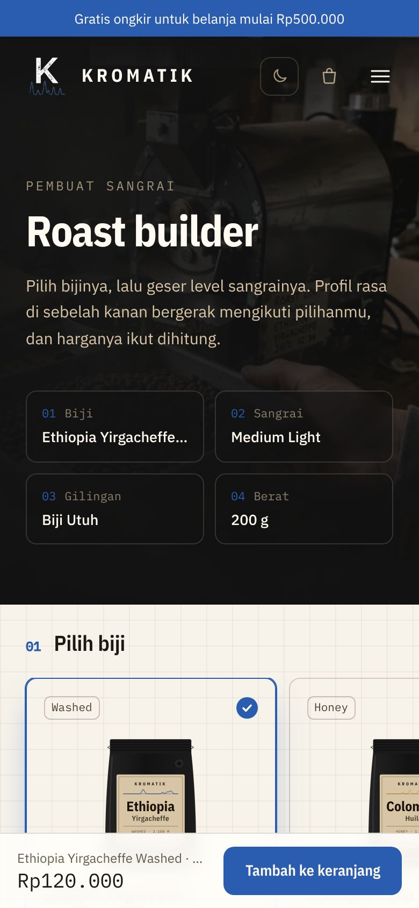
</p>

## Fitur

**Toko (pembeli)**
- Landing dengan katalog kartu produk: harga mulai dari, status stok, rating, pencarian, sortir, dan filter proses.
- Roast builder dengan flavor wheel dan kromatogram aroma; kantong kemasan dirender SVG per kopi.
- Keranjang multi-item (tamu di session, user login di database; keranjang tamu digabung saat login).
- Roast builder: 14 biji demo (6 proses, termasuk Carbonic Maceration), 4 level sangrai, 6 gilingan, berat 100 g / 200 g / 250 g / 500 g / 1 kg.
- Checkout dengan add-on opsional (kemasan hadiah, kartu ucapan; harga diatur admin, disimpan per pesanan), voucher, ongkir (gratis di atas batas tertentu), bayar online (simulasi) atau COD (bisa dimatikan / dibatasi nominalnya).
- Lacak pesanan per tahap produksi, riwayat pesanan + "Beli lagi", buku alamat, ulasan pembeli terverifikasi.
- Email transaksi (pesanan diterima, lunas, dikirim + resi, dibatalkan), notifikasi dalam aplikasi, login Google/Facebook (opsional).
- FAQ dan kebijakan (ID/EN), tema terang/gelap, dua bahasa ID/EN, halaman error bermerek, SEO dasar + sitemap.

**Panel internal (admin & roastery)**
- Dashboard, pesanan (cetak invoice/label kirim, hanya setelah lunas), antrian roastery, jurnal sangrai.
- Kelola kopi (termasuk foto), stok dengan riwayat pergerakan, voucher, pelanggan, ulasan (moderasi), pengguna & peran, log aktivitas, pengaturan toko.
- Laporan penjualan dengan ekspor Excel dan PDF.

## Menjalankan di lokal

Butuh PHP 8.3+, Composer, Node 20+, dan MySQL (Laragon cukup).

```bash
git clone https://github.com/nadiapramesti/brule-coffee-lab.git
cd brule-coffee-lab
composer install
npm install

cp .env.example .env
php artisan key:generate
# edit .env: DB_CONNECTION=mysql, DB_DATABASE=brule, DB_USERNAME, DB_PASSWORD
# buat database kosong "brule" dulu

php artisan migrate --seed
php artisan storage:link      # supaya foto produk yang diupload tampil
npm run build                 # atau: npm run dev
php artisan serve
```

Setelah `git pull` berikutnya: `php artisan migrate`, `npm run build`, `php artisan view:clear`, lalu hard refresh (Ctrl+F5).

### Akun demo (dari seeder)

| Peran | Email | Password |
|---|---|---|
| Admin | `admin@brule.test` | `password` |
| Roaster | `roaster@brule.test` | `password` |
| Pembeli | `customer@brule.test` | `password` |

Voucher contoh: `KOPIBARU10`. Ganti semua password dan kontak toko (Admin → Pengaturan) sebelum dipakai di luar demo.

### Konfigurasi opsional (`.env`)

- **Email:** `MAIL_MAILER=log` menulis email ke `storage/logs/laravel.log`. Untuk kirim sungguhan isi `MAIL_*` dengan SMTP, dan pastikan `APP_URL` benar karena tombol di email memakai alamat itu.
- **Login sosial:** `GOOGLE_CLIENT_ID` / `GOOGLE_CLIENT_SECRET` (dan Facebook). Jangan pernah commit `.env`.

## Tes

```bash
php artisan test
```

Suite Pest mencakup alur pesanan, keranjang, pembayaran COD/online, stok, voucher, akun dan alamat, ulasan, email, halaman statis, dan hak akses admin.

## Struktur singkat

```
app/Livewire/            halaman toko dan panel (satu komponen per halaman)
app/Livewire/Admin/      modul admin
app/Models/              Order (logika pesanan), Coffee (stok), Cart di app/Support
app/Mail/ + Support/     email transaksi, keranjang
resources/views/         blade (layouts/brule = toko, layouts/panel = admin)
lang/                    terjemahan ID/EN (en.json, pages.php untuk halaman statis)
docs/DEMO.md             skenario dan checklist demo
docs/screenshots/        gambar untuk README
```

## Catatan keputusan

- Harga dan stok selalu dihitung ulang di server saat pesanan dibuat; keranjang hanya menyimpan pilihan, bukan harga.
- Stok biji mentah dikunci per kopi saat checkout supaya dua pembeli tidak bisa memesan sisa yang sama.
- Pembayaran online memakai Midtrans Snap (sandbox) bila `MIDTRANS_SERVER_KEY` dan `MIDTRANS_CLIENT_KEY` diisi di `.env`. Tanpa kunci, tombol kembali ke mode simulasi. Webhook: `POST /midtrans/notification` (butuh URL publik, mis. ngrok; di localhost pakai tombol "Cek status pembayaran").

## Lisensi

Kode dirilis dengan [lisensi MIT](LICENSE). Logo, nama, dan foto kemasan BRÛLÉ adalah aset merek dan tidak termasuk dalam lisensi ini.
